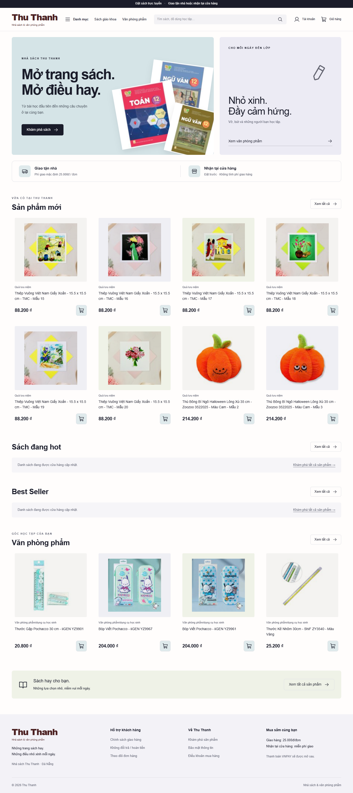

# Nhà sách Thu Thanh

Frontend **Next.js 16 + React/TypeScript/Tailwind**, backend **Laravel 12 + MySQL 8.4**. Stack theo xác nhận mới nhất của chủ dự án về yêu cầu giảng viên (D34). Laravel quyết định quyền, giá, tồn, giỏ và trạng thái đơn; frontend dùng cookie/session + CSRF.

Đã có bản web local: trang chủ, danh mục/tìm kiếm/lọc/sắp xếp/phân trang, đăng ký/đăng nhập chung, popup thêm giỏ, giỏ, checkout lấy báo giá/tạo đơn, xem/hủy/đặt lại đơn; admin sản phẩm/ảnh/archive/danh mục/tồn/đơn/doanh thu/đối soát. **136 sản phẩm và136 ảnh** đã nhập từ workbook cập nhật của chủ dự án, đúng giá bán/tồn cửa hàng.

Phí giao mặc định **25.000đ/đơn**, pickup0đ; không đổi trả/hoàn tiền. VNPAY/QR thật được hoãn, đơn chưa tự paid; doanh thu tính tiền hàng sau giảm giá, phí giao hàng thống kê riêng; có lọc và CSV. Chưa deploy hoặc nghiệm thu release.

Giao diện hiện hành **V24 / D45**: logo riêng Thu Thanh, panel trắng/ngăn xám,3banner Phương Nam,footer8nhãn hàng/bản tin/địa chỉ mới;Figma Landing page riêng và flow mở ngang. Ảnh gốc HD136SKU, XEM NHANH và auth giữ số lượng. [Chạy web](docs/CHAY-WEB-VA-LARAVEL.md) · [Import Figma V24](thu-thanh-figma-clicon/HUONG-DAN.md) · [Nguồn ảnh](docs/ASSET-SOURCES.md). Canvas cũ cần chạy lại plugin để cập nhật.

Trang chủ chỉ có **Bán chạy nhất / Sản phẩm mới / Gợi ý cho bạn**, ảnh lớn và Xem nhanh căn đều. Vào **http://localhost:3000/admin**; nếu không nhớ tên đăng nhập, chạy `php artisan admin:account` trong backend. Hướng dẫn phục hồi mật khẩu local và quản lý đầy đủ ở [Chạy web và admin](docs/CHAY-WEB-VA-LARAVEL.md).

## Demo doanh số và hiệu năng

Đã tạo riêng `thu_thanh_demo` với 1.000 đơn ngẫu nhiên. Không có mật khẩu demo mặc định; dùng `php artisan admin:password --env=demo` để tự chọn. [Chạy demo và admin](docs/CHAY-WEB-VA-LARAVEL.md). Form sản phẩm có phần trăm giảm; 35.000đ giảm5% thành33.250đ. Footer bỏ hai dòng chữ theo yêu cầu, giữ8logo; bán chạy có biểu tượng lửa và xếp số lượng paid.

Đã tối ưu public snapshot/cache, truy vấn gợi ý bounded, production standalone/FPM/Redis/Nginx. Đo local20request đồng thời:p95~601ms,0lỗi/200request. **Chưa nghiệm thu10k production**, chưa deploy. [Hiệu năng và phần còn cần hạ tầng](docs/PERFORMANCE.md) · [Source/cleanup/khôi phục](docs/REPOSITORY-MAP.md).

## Mở trên máy hiện tại

Terminal thứ nhất:

```powershell
cd D:\ThuThanh-WebDesign
powershell -ExecutionPolicy Bypass -File scripts/mysql-local.ps1 -Action start
cd backend
php artisan serve --host=localhost --port=8000
```

Terminal thứ hai:

```powershell
cd D:\ThuThanh-WebDesign\frontend
npm run dev
```

Mở **http://localhost:3000**. Dependencies đã được cài trên máy này; dùng `npm ci` khi thiết lập máy khác. PHP/MySQL đã có, không bootstrap lại hoặc xóa data. Dùng localhost nhất quán ở các terminal/trình duyệt.

Chưa tạo admin thật thay người dùng. Trong backend, chạy `php artisan admin:create` để tự nhập thông tin và mật khẩu riêng. Khách có thể đăng ký từ website. Khi kiểm luồng hết hạn/xóa ảnh, chạy thêm `php artisan schedule:work` và `php artisan queue:work database --tries=5 --timeout=60` ở terminal riêng.

## Kiểm chứng

- Backend84 tests/1353 assertions passed trên MySQL test; HTTP cookie/CSRF11 và ops5 passed.
- Frontend6 API-client tests, production build, typecheck và npm audit passed. Browser QA với Laravel/MySQL thật: cart/checkout/reorder/roles/admin create/update/hide/upload/stock, mobile và keyboard.
- Chưa đo coverage>70%, chưa CI remote, Sandbox thật, Docker staging/restore hoặc deploy production. Git local chưa commit/remote.

Chi tiết: [frontend README](frontend/README.md), [frontend verification](docs/VERIFICATION.md), [backend verification](docs/VERIFICATION.md), [local setup](docs/LOCAL-SETUP.md), [audit workbook](docs/PRODUCT-IMPORT-AUDIT.md).

## Giao diện hiện tại

Nguồn là plugin Figma local V15.1 được chủ dự án chọn; chưa có canvas URL/export để pixel-diff. Ảnh sách lấy từ workbook/API, font/icon/palette/layout bám source plugin. Banner mẫu đã có nội dung giới thiệu, chưa phải banner artwork cuối riêng.



[Trang chủ mobile](docs/qa/home-mobile.png) · [Danh mục mobile](docs/qa/products-mobile.png)

## Tài liệu và dữ liệu

[PRD](docs/PRD.md) · [API](docs/API.md) · [Database](docs/DATABASE.md) · [Decisions](docs/DECISIONS.md) · [Task/status/handoff](docs/HANDOFF.md) · [Đối chiếu môn học](docs/COURSE-RUBRIC-AUDIT.md).

Checkpoint chính thức ở docs/ gốc; Thu-Thanh-AI-Build-Pack giữ tham khảo. Giữ .runtime/mysql-data, env, APP_KEY và storage public/private khi nâng cấp. Không commit secret, không reset/clean/migrate:fresh development. Docker templates chưa được chạy; xem deploy/README.md khi đến giai đoạn staging.
